<div align="center">



[](https://git.io/typing-svg)

<br/>

[](https://github.com/CarlosZambonii)
[](https://tryhackme.com/p/naza1mm)

</div>

---



**`$ whoami`**

```
carlos zamboni
ex-devops/fullstack, now moving into offensive security / red team
based in sorocaba, sp, open to remote roles
contributor @ ntari (us non-profit)
```

**`$ cat current.txt`**

```
[+] certified → TryHackMe Pre Security (SEC0)
[*] studying  → red team path @ TryHackMe
[*] target    → Red Team / Pentest @ remote
```

<br clear="right"/>


---




<sub>→ <a href="https://tryhackme.com/p/naza1mm">TryHackMe profile</a></sub>

---




<sub>→ <a href="https://github.com/CarlosZambonii/devforge">DevForge</a> · <a href="https://github.com/CarlosZambonii/Agrinet-Brazil">Agrinet</a></sub>

---




<sub>→ <a href="https://github.com/buildkite/buildkite-agent-scaler/pull/337">Buildkite PR #337</a></sub>

---


**offensive security**

![Nmap](https://img.shields.io/badge/Nmap-0E83CD?style=flat-square&logo=data%3Aimage%2Fsvg%2Bxml%3Bbase64%2CPHN2ZyB4bWxucz0iaHR0cDovL3d3dy53My5vcmcvMjAwMC9zdmciIHZpZXdCb3g9IjAgMCA1MTIgNTEyIj48cGF0aCBmaWxsPSJ3aGl0ZSIgZD0iTTQ1MC4zOTIgMjY4LjIxNmMyLjEyOCAxLjQ3NSA0LjE3OCAyLjMgNi40ODQgMy41NTRjMS44NyAxLjAxNyAzLjc3MyAxLjk3IDUuNjQ5IDIuOTczYzEuNDYyLjc4MSA0LjE3MSAyLjQyNSAyLjUyOSA0LjM0NWMtMS4wNjcgMS4yNTEtMy42NSAxLjA1NS01LjE2MyAxLjI2N2MtMi4zOTkuMzMzLTUuMzQ5LjIwNi03Ljc0IDBjLTIuOTMtLjI1NC01Ljk5Mi40NC04Ljk3NC40NGMtMi4xNTIgMC00LjMyLjA5My02LjQ0OS4wODdjLS43NjctLjAwMi0xLjczNC4xNzYtMi4yNTgtLjVjLS41NDUtLjcwMi0uMTYzLTEuNDgyLjI2My0yLjA2NmMuNTExLS42OTYuOTkyLTEuNjI1IDEuNjA3LTIuMTY5Yy41NS0uNDg0IDEuMjczLS44MiAxLjgyNS0xLjI0NmMxLjM0NC0xLjAzNiAxLjgxMS0yLjEzMi42Mi0zLjQ3Yy0xLjE4NC0xLjMzMy0yLjA1NC0yLjI3Ni0yLjExNS00LjE2MmMtLjA3Ny0yLjQwOSAxLjQ1My0yLjkwNCAzLjUwMy0zLjQzYzMuMDctLjc4NyAyLjgxLS4yNiA1LjM4MSAxLjIxYzEuMjMxLjcwNSA0LjI1NiAyLjc2MyA0LjgzOCAzLjE2N20tMzkxLjgzOC45NjVjLTIuMTY2IDEuNDE4LTQuMjM3IDIuMTktNi41NzYgMy4zODJjLTEuODk1Ljk2OC0zLjgyMyAxLjg3LTUuNzI0IDIuODI1Yy0xLjQ4My43NDItNC4yMzQgMi4zMTMtMi42NDEgNC4yNzdjMS4wMzMgMS4yNzkgMy42MiAxLjE1IDUuMTI4IDEuNDAxYzIuMzg4LjM5NiA1LjM0LjM0NiA3LjczNy4yMDRjMi45MzUtLjE3OSA1Ljk3OC41OTcgOC45NTguNjczYzIuMTUyLjA1OSA0LjMxNi4yMDggNi40NDUuMjU3Yy43NjYuMDE4IDEuNzI4LjIyMiAyLjI3LS40NDFjLjU2NC0uNjg2LjIwMi0xLjQ3Ni0uMjA5LTIuMDdjLS40OTItLjcxLS45NDktMS42NTEtMS41NDktMi4yMTFjLS41MzgtLjUtMS4yNS0uODUzLTEuNzkxLTEuMjkzYy0xLjMxNy0xLjA3Mi0xLjc1Ni0yLjE4LS41My0zLjQ4NmMxLjIyLTEuMzAyIDIuMTE0LTIuMjIxIDIuMjI0LTQuMTA1Yy4xNC0yLjQwNi0xLjMwMy0zLjM0My0zLjQxMy0zLjUyMmMtMi43MTQtLjIzLTIuNjA5LjMyNy01LjMwNCAxLjMzM2MtMS4zMy40OTYtNC40MzIgMi4zODctNS4wMjUgMi43NzZtNDUxLjAyMiAxNy4wMTRjLTE2LjY4MyAxOS4yNC00OC4zMjggOS42MDYtMTAwLjU2NiAzNC41OTdjLTY5LjMyNSAzMy4xNjctNzMuODkgNTIuODk1LTE1My42MzQgNTMuNDU5Yy04Mi40ODguNTg0LTg0LjM2NS0yMi4wNjktMTU3LjQ0NS01NC42MzJjLTU3LjY4Ni0yNS43MDMtODkuNjMxLTE0LjE3LTk2LjQ2LTM0LjMwM2MtOS4zMDUtMjYuNDM0IDI3LjgtNTAuODA1IDQ4LjA4My02NS4wOWM5Mi4wMjQtNjQuODAyIDEzMi4xMS04Mi4yNTkgMjAzLjg2OS04Mi4xOTFjNzcuMDMyLTQuMzk3IDE1MS41MjEgNDAuODUxIDIwNy4xOSA4Mi4xOTJjMTkuODI5IDE0LjcyNSA2MS44OTMgNDIuOTEgNDguOTYzIDY1Ljk2OE0yNTguNTk5IDI2OS42OWwtLjAwOCAxNi4zNDdjMTcuMDk2LTEuNDk2IDMwLjc0My0xNS4zMjUgMzIuMzgtMzIuNzY3bC0xNi4zNi4wMzJjLTEuMzg0IDguNDMxLTcuODUyIDE1LjA2Ni0xNi4wMTIgMTYuMzg4bTkuNDQyLTE2LjM3NGwtOS40MzUuMDE4bC0uMDA0IDkuOGM0LjYyMi0xLjE2OSA4LjI1My00Ljk2NiA5LjQzOS05LjgxOG0uMS02LjQxNWMtMS4wOS01LjAxNC00LjgtOC45NTUtOS41MjctMTAuMTU1bC0uMDA0IDEwLjE3NHptLTQ4LjEwNS4wOTVsMTYuNTM3LS4wMzNjMS4yMjMtOC40NjIgNy41NTMtMTUuMiAxNS42My0xNi43MDhsLjAwOC0xNi43OTVjLTE3LjIzNCAxLjYyOC0zMC44OCAxNS44MTMtMzIuMTc1IDMzLjUzNm0zMi4xNTEgMTUuOTg5bC4wMDUtOS42MzhsLTguOTc2LjAxOGMxLjE1NyA0LjY2NiA0LjU4NCA4LjMyNiA4Ljk3MSA5LjYybS0xNS41NDUtOS42MDdsLTE2LjU2LjAzM2MxLjY4NyAxNy4yODIgMTUuMTczIDMwLjk5NiAzMi4wOTQgMzIuNjExbC4wMDgtMTYuNDA1Yy03LjkyLTEuNDg3LTE0LjE1OS04LjAwMS0xNS41NDItMTYuMjRtMTUuNTUzLTYuNDQ2bC4wMDUtMTAuMDQ2Yy00LjUzNCAxLjMzMy04LjA3IDUuMTgyLTkuMTE0IDEwLjA2NHptMzguODA5LS4wNzdjLTEuMzYyLTE3LjcyOC0xNS4wOTEtMzEuODc3LTMyLjM3OC0zMy40MDZsLS4wMDggMTYuNzRjOC4yNTIgMS4zNDUgMTQuNzY4IDguMTI2IDE2LjA0IDE2LjY5OXptLTcxLjM2NyA4Ni4wODRjLTM0LjA4NS0xMy43NS01OC4wODMtNDYuNTU3LTU4LjA4My04NC44NTljMC0yMC45MjggNy4xNzctNDAuMjEgMTkuMjM0LTU1LjY0OGMtMjUuMDk4IDEwLjY0NS01OC41MjQgMzAuODUyLTExMy43MzcgNjkuMjEyYy04LjczOCA2LjA3LTM1LjE2MiAxMy4xNC0yOC45MzEgMTguOThjNC42OSA0LjM5OSAyOS45MDUgMS4xNzMgNDguNjcgNy4wMzdjNjYuOTAyIDIwLjkwNyA5Ni45MTQgMzguMjQ4IDEzMi44NDcgNDUuMjc4TTQ0NS42NiAyNjEuODZjLTUxLjUwNC0zNi45ODYtODYuNzc2LTU3LjktMTE1LjU2NS02OS4yNjdjMTEuOTgxIDE1LjQxMiAxOS4xMDQgMzQuNjMyIDE5LjEwNCA1NS40ODdjMCAzNy4wMzEtMjIuNDM2IDY4LjkxNy01NC43MjcgODMuNDJjNDMuMTY1LTkuOTQgODYuMTM3LTMyLjc4OSAxMjcuMTQ2LTQ0LjEzMmMyOC4wMTYtNy43NTEgMzguOTk1LTEuNDY2IDUxLjMxLTcuNjIzYzQuOTY1LTIuNDgzLTIwLjEyOC0xMi43Ni0yNy4yNjgtMTcuODg1Ii8%2BPC9zdmc%2B)


**infra & cloud**


**languages**


**security & CI/CD**


---


<div align="center">


</div>

---

<div align="center">


</div>

---

<div align="center">


</div>
